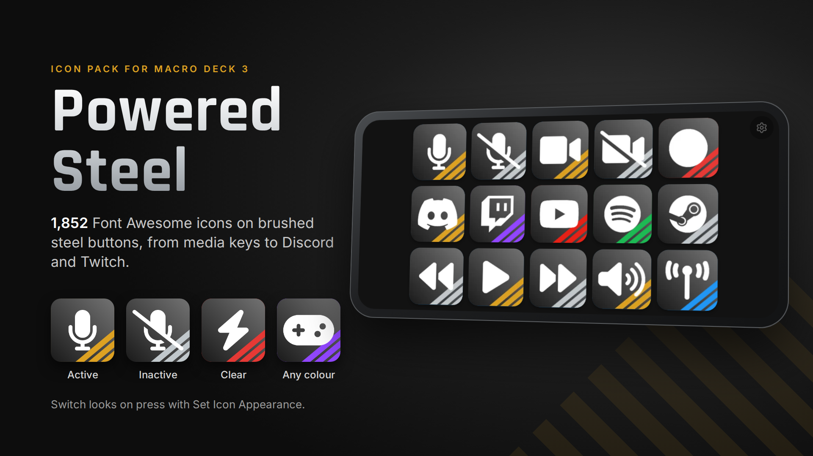
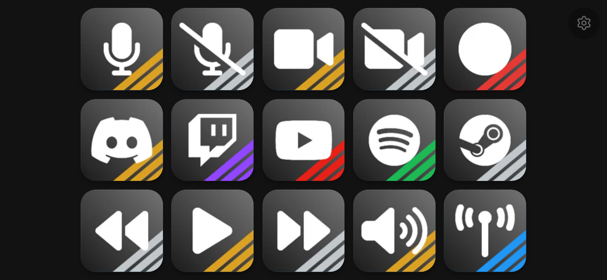

# Powered Steel



An icon pack for [Macro Deck 3](https://macro-deck.app): every free Font Awesome 6 icon on a brushed steel
button.

Each icon has three looks:

| Look | How to use it |
| --- | --- |
| Active (gold stripes) | The icon's default image |
| Inactive (grey stripes) | Pick the **Inactive** appearance next to the icon, or switch to it with the **Set Icon Appearance** action |
| Clear (see-through stripes) | Pick the **Clear** appearance; the stripes take the button's background colour |

Switching between Active and Inactive with **Set Icon Appearance** shows a toggle's state on one button.



## Building

The pack is generated by [src/build.py](src/build.py). It downloads Font Awesome Free 6.2.0 (checked
against a pinned SHA-256), renders every icon through the template [src/Icon_Powered_Steel.svg](src/Icon_Powered_Steel.svg)
with Inkscape, and writes `dist/Powered-Steel-<version>.macroDeckIconPack`.

Requirements: Python 3.9 or newer, Inkscape 1.2 or newer on `PATH`, and Pillow with WebP support.

```bash
python3 src/build.py --version 2.0.0
python3 src/check_pack.py dist/Powered-Steel-2.0.0.macroDeckIconPack
```

`--icons play,pause,discord` builds only those icons, for a quick look at a template change. Rendered PNGs
are kept in `src/output/png` and reused; delete that folder after changing the template.

[src/check_pack.py](src/check_pack.py) checks the pack the way Macro Deck's import and the Store's
signing step read it: declared file digests, a master image for every icon and appearance, icon names,
appearance traits and the size limits.

## Releasing

1. Tag the commit: `git tag v2.0.1 && git push origin v2.0.1`
2. The [Build workflow](.github/workflows/build.yml) builds and checks the pack and attaches it to a new
   GitHub release.
3. Import the pack into Macro Deck once and look at a few icons and their appearances.
4. In the Creator Portal, open the Powered Steel project, start version `2.0.1`, upload the
   `.macroDeckIconPack` from the release and submit it for review.

Icon ids are derived from the icon names, so an update keeps the icons on users' buttons. Renaming or
removing an icon in a later Font Awesome version drops it from the pack, but Macro Deck keeps icons a
button still uses.

## Macro Deck 2

The original Macro Deck 2 pack is at tag `v1.0.0` of this repository, and the Macro Deck 2 category packs
are in the `Macro-Deck-Icon-Powered-Steel-*` repositories. When you move to Macro Deck 3, its migration carries the
Macro Deck 2 icons on your buttons over.

## Attribution

The icons are [Font Awesome Free](https://fontawesome.com) 6.2.0 by Fonticons, Inc., distributed under the
[CC BY 4.0 License](https://fontawesome.com/license/free). Background images were added to each icon. Brand
icons are trademarks of their respective owners.

The button template and build scripts are under the [MIT License](LICENSE).
